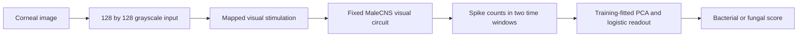
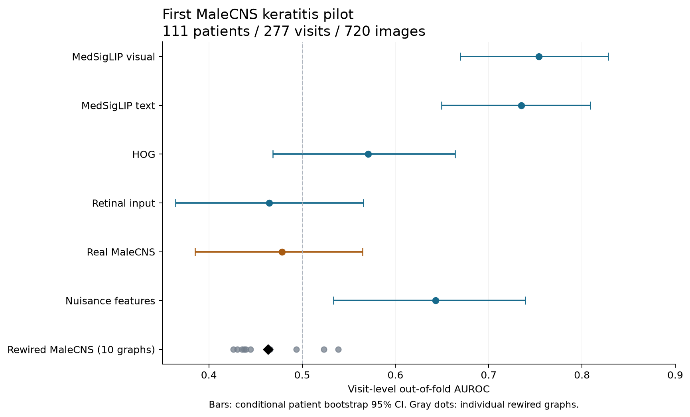
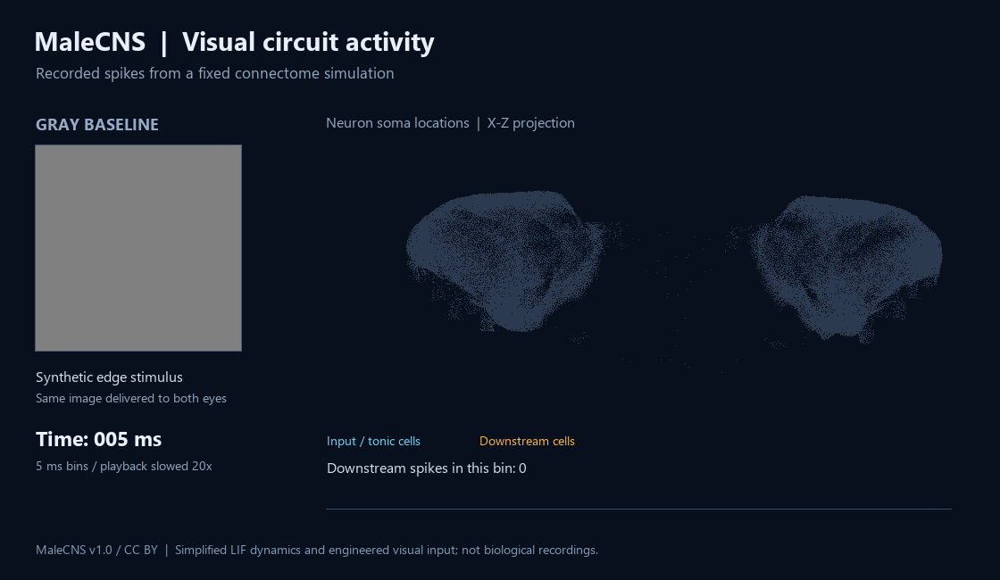

# A small connectome keratitis experiment

For a bit of fun, I tried using a fruit fly's visual circuitry to classify bacterial versus fungal keratitis. The result was around chance. This repository shares the approach, aggregate results, and synthetic visualization from that experiment.

The model uses a **fixed visual subset of MaleCNS v1.0**, a simplified leaky integrate-and-fire (LIF) simulation adapted through Fly OCR, and a small supervised classifier. The circuit is frozen; the final classifier learns from culture labels. It is an exploratory research experiment.

Project introduction: [TinyStar Labs](https://tinystarlabs.com/#malecns-project). Software citation metadata: [CITATION.cff](CITATION.cff).

## How it works



The pilot simulated 101,939 neurons and 11,757,352 directed connections. It read responses from 91,490 non-directly-driven visual neurons. Images were presented for 100 ms following a 100 ms gray baseline. For each neuron, spike counts from 0-50 and 50-100 ms became two features. We applied `log1p` per image, averaged features within a visit, then fitted scaling, PCA to 28 dimensions, and class-balanced logistic regression using training patients only.

## What happened

The private retrospective cohort contained 111 patients, 277 visits, and 720 images. All images and visits of each patient stayed in the same outer fold. The primary evaluation used five fixed patient-disjoint folds, with grouped inner cross-validation for regularization selection.

| Representation | Visit-level OOF AUROC | Conditional patient-bootstrap 95% interval |
| --- | ---: | --- |
| Real circuit, masked lesion crop | 0.479 | 0.385-0.565 |
| Rewired crop circuits, mean of 10 individual AUROCs | 0.464 | See per-circuit results |
| Raw retinal input, crop | 0.464 | 0.364-0.566 |
| MedSigLIP visual PCA-28, crop | 0.754 | 0.670-0.828 |
| Real circuit, whole image | 0.462 | 0.383-0.544 |

For the crop experiment, real wiring minus the mean rewired result was +0.015 AUROC, with a paired 95% interval of -0.037 to +0.064. The predefined pilot continuation criterion was not met. The whole-image extension also did not show convincing added value from the real wiring.

These findings concern this input mapping, simulation, and readout. They do not establish a general limit of biological circuits. The same previously analyzed cohort was used; there was no external validation. Repeated visits can include treatment effects, so this is not a first-presentation diagnostic estimate.





The animation shows **simulated** spikes in response to a synthetic edge. Its positions come from the public connectome. It contains no patient images. Input/tonic cells are blue and downstream cells are yellow; colors do not represent diseases.

## Run the small public demo

Python 3.11 or 3.12 and [uv](https://docs.astral.sh/uv/) are required.

```sh
uv sync --frozen --group dev
uv run --frozen pytest -q
uv run --frozen connectome-pilot demo
```

The demo exercises patient-grouped evaluation on randomly generated **tabular** data. It does not simulate the connectome and its score is not keratitis performance.

## Run the circuit on synthetic inputs

The simulation extra uses Fly OCR at a pinned commit. Downloads and compilation are explicit. On Windows, install Visual Studio C++ Build Tools; the adapter discovers MSVC or uses a developer shell. Linux/macOS require an upstream-compatible C++ compiler.

```sh
uv sync --frozen --extra simulation --group dev
```

Follow [the circuit setup guide](docs/SETUP.md) to download public source data, prepare the visual graph, and run the synthetic stimuli. The clinical dataset, clinical embeddings, saved predictions, and fitted patient models are not distributed.

## What other researchers can do

| Use | What this package provides |
| --- | --- |
| Explore simulated visual responses | Prepare the public visual graph and run six synthetic image stimuli. |
| Try their own labeled image dataset | Encode local images as circuit spike counts and train/evaluate a logistic readout with patient-disjoint folds. |
| Test whether the wiring helps | Generate degree- and signed-strength-preserving rewired controls and run the same image encoding and evaluation on them. |
| Compare another representation | Evaluate precomputed image features or embeddings with the same grouped evaluation pipeline. Baseline feature extractors are not included. |
| Develop a different experiment | Modify the Python code to change input mapping, dynamics, readout windows, or graph selection. These changes require coding. |

The public package has been checked on Windows with the pinned upstream simulator. Linux/macOS use the upstream compiler path and have not been tested for this extraction. Full connectome preparation and simulation require substantial storage, memory, and compute.

This is a reusable experimental starting point. It contains no pretrained diagnostic model. The original clinical AUROCs cannot be independently reproduced from the public files because the clinical dataset is private. Using another imaging task also requires suitable labels, grouping, and an evaluation design for that task.

## Contents

- `src/connectome_pilot/`: portable graph selection, fixed encoding, rewiring controls, and grouped evaluation.
- `docs/METHODS.md`: the English experimental logic and locked settings.
- `docs/RESULTS.md`: English crop and whole-image results, including comparisons and limitations.
- `docs/EXPLANATION.md`: a short explanation suitable for a post.
- `docs/BRIEF_EN.pdf`: a three-page English visual brief.
- `results/`: aggregate metrics only.
- `assets/`: an English synthetic GIF and aggregate chart.

This is a portable extraction of the main research logic. The published numbers come from the archived private pilot, not a new clinical rerun of this package. Supplementary calibration analyses, clinical attribution movies, original private data importers, and unattended queues remain in the private archive. The public `protocol.json` is a redacted explanatory copy, not the original byte-identical protocol lock.

## Credits and licensing

- [MaleCNS v1.0](https://male-cns.janelia.org/download/): HHMI Janelia/FlyEM, University of Cambridge, MRC LMB, Google Research, and collaborators; CC BY 4.0. Publication: [Berg et al.](https://doi.org/10.1016/j.cell.2026.08.015).
- [Fly OCR](https://github.com/jerryjliu/fly_ocr), commit `48cf341e99c17dc911fb09fdc8419d98b4d0ea86`: MIT. It supplies the upstream neural simulation and input projection implementation.
- [DOOMFLY](https://github.com/nftechie/doomfly), commit `71ecf53d78eaffaf1a57ed7b0ccf5d458abc9f33`: MIT; acknowledged through Fly OCR's implementation lineage.

The pilot adds the visual subgraph selection, keratitis preprocessing and response features, rewiring controls, and patient-grouped comparison. We did not reconstruct the original connectome or write the upstream neural equations.

The author's code and original documentation are released under the [MIT License](LICENSE), copyright 2026 TinyStar Labs and contributors. Third-party software retains its own notices in `licenses/`. MaleCNS data and the data-derived graph/position content used in the synthetic figures retain their CC BY 4.0 attribution requirements; MIT does not replace those terms. See [THIRD_PARTY_NOTICES.md](THIRD_PARTY_NOTICES.md).

If you use this work in research, please cite the software using `CITATION.cff` and acknowledge the upstream connectome and simulation projects. This citation request is separate from the MIT license conditions.
